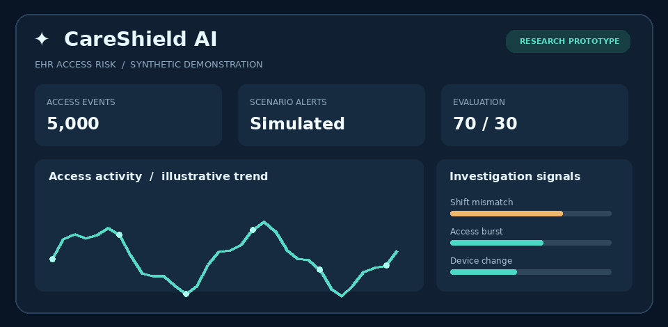
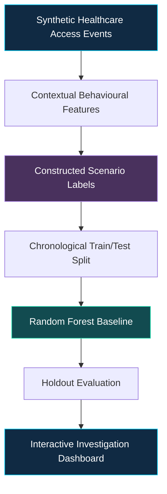

<div align="center">



<br/>

<h1>
  🛡️ CareShield AI
</h1>

<h3>
  <em>Smarter Security. Safer Healthcare.</em>
</h3>

<p>
  <strong>
    Context-Aware Healthcare Record Access Risk Lab
  </strong>
</p>

<p>
  An intelligent cybersecurity research prototype exploring
  suspicious electronic health record access through
  behavioural analytics, machine learning and clinical context.
</p>

<br/>


<br/><br/>


<br/><br/>

<a href="#-the-research-challenge">Research</a>
&nbsp; • &nbsp;
<a href="#-core-capabilities">Features</a>
&nbsp; • &nbsp;
<a href="#-technology-stack">Technology</a>
&nbsp; • &nbsp;
<a href="#-research-methodology">Methodology</a>
&nbsp; • &nbsp;
<a href="#-quick-start">Get Started</a>

<br/><br/>

<h2>🔍 When Is Unusual Access Actually Suspicious?</h2>

<p>
  <em>
    Not every late-night login is a cyberattack.
    Not every unusual access event is a security breach.
    Context changes everything.
  </em>
</p>

</div>

---

## 🧠 The Research Challenge

Healthcare professionals frequently access patient records outside conventional working hours.

Traditional rule-based monitoring can flag legitimate activities, such as emergency access or night-shift care, as suspicious.

**CareShield AI explores a different approach:**

> Can contextual access signals help distinguish routine clinical activity from potentially suspicious electronic health record access?

The project investigates this question using reproducible synthetic data, transparent risk indicators and machine learning evaluation.

---

## 🚀 Core Capabilities

<table>
<tr>
<td width="50%">

### 🔐 Contextual Access Analysis

Examines shift schedules, patient assignments, access frequency and authentication behaviour.

</td>
<td width="50%">

### 🧠 Machine Learning

Uses a Random Forest baseline to classify constructed suspicious-access scenarios.

</td>
</tr>

<tr>
<td>

### 📊 Interactive Analytics

Visualises event trends, access patterns, role-level alerts and investigation priorities.

</td>
<td>

### 🚨 Investigation Queue

Allows analysts to review flagged events, examine scenario risk factors and export records.

</td>
</tr>

<tr>
<td>

### 🧪 Reproducible Experiments

Supports configurable simulation seeds, chronological evaluation and automated testing.

</td>
<td>

### 🏥 Privacy-First Research

Uses synthetic healthcare records without exposing real patient or staff information.

</td>
</tr>
</table>

---

## ⚙️ Technology Stack

<div align="center">

| Layer | Technologies |
|:---|:---|
| **Programming** | Python |
| **Interactive Application** | Streamlit |
| **Data Processing** | Pandas, NumPy |
| **Machine Learning** | Scikit-learn, Random Forest |
| **Visual Analytics** | Plotly |
| **Testing** | Pytest |
| **Data** | Synthetic EHR access logs |

</div>

---

## 🔬 Research Methodology



**Evaluation includes:**

- Average precision and ROC-AUC
- False-positive and false-negative counts
- Chronological holdout testing
- Review of contextual scenario risk factors

**Research limitation:** Labels are generated using simulated behavioural rules. The resulting performance measures the model's ability to learn those rules, not its effectiveness against real hospital cyberattacks.

---

## 💻 Quick Start

Clone the repository:

```bash
git clone https://github.com/tasnem-tech/careshild-ai.git
```

Enter the project folder:

```bash
cd careshild-ai
```

Install dependencies:

```bash
python3 -m pip install -r requirements.txt
```

Launch the dashboard:

```bash
python3 -m streamlit run app.py
```

Run automated tests:

```bash
python3 -m pytest -q
```

---

## 🗺️ Future Research Directions

- [ ] Independently designed threat scenarios
- [ ] Rule-based versus machine learning comparison
- [ ] Grouped validation across staff and simulated hospitals
- [ ] Model calibration and threshold-cost analysis
- [ ] Validated local explainability methods
- [ ] Emergency access and false-positive analysis

---

<div align="center">

<h2>👩‍💻 Researcher & Developer</h2>

<h3>Tasnem Islam Prome</h3>

<p>
  Applied Computing • Data Analytics • Machine Learning • Research
</p>

<a href="https://github.com/tasnem-tech">
  
</a>

<br/><br/>

<strong>Built to explore a real healthcare cybersecurity problem.</strong>

<br/>

<sub>
  Research prototype • Synthetic data only • Not validated for operational or clinical use
</sub>

</div>
